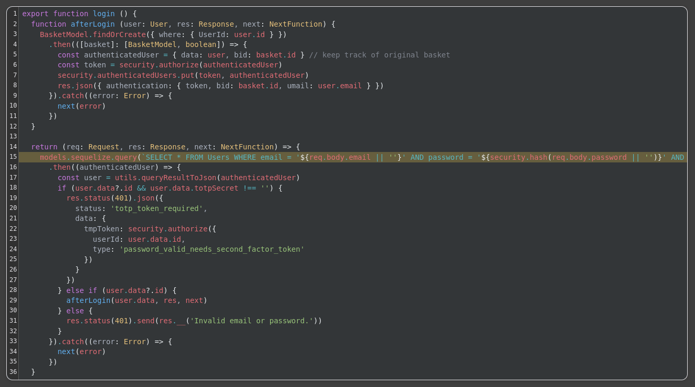
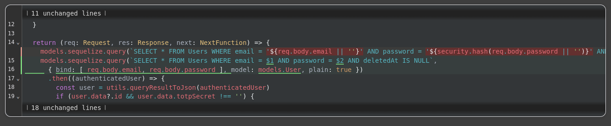
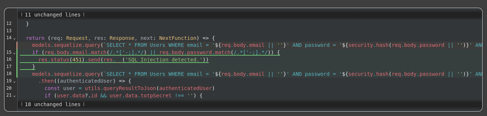
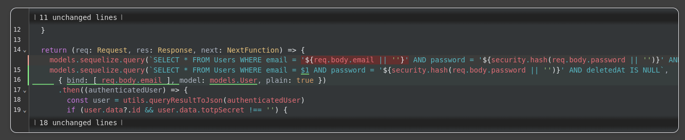
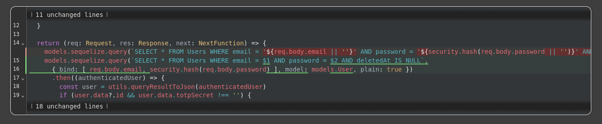

# Login Admin (SQL Injection)

**Category:** Injection — OWASP Top 10 A03:2021

> For educational purposes only. Performed on a local, personal OWASP Juice Shop instance.

## Summary

The login form builds its SQL query by directly concatenating the user input. By injecting
a crafted string into the email field, the password check is commented out and the query
always evaluates to true. The application then logs the attacker in as the first user in
the database — the administrator — without knowing any password.

## Steps to Reproduce

1. Open the application at `http://localhost:3000` and go to the **Login** page.
2. In the **Email** field enter:
   ```
   ' OR 1=1 --
   ```
3. In the **Password** field enter any value, e.g. `123`.
4. Submit the form → you are logged in as the administrator (`admin@juice-sh.op`).
5. From the **Score Board** you can open the related coding challenge (*Find It* / *Fix It*)
   to inspect the vulnerable code.

### Why it works

The login query is assembled roughly like this:

```sql
SELECT * FROM Users WHERE email = '<input>' AND password = '<hash>'
```

With `' OR 1=1 --` as the email, the query becomes:

```sql
SELECT * FROM Users WHERE email = '' OR 1=1 --' AND password = '...'
```

`OR 1=1` is always true, and `--` comments out the rest of the query, including the
password check. The database returns all users and the application logs you in as the
first one — the administrator.

## Dangers and Consequences

SQL Injection is one of the most severe web vulnerabilities. An attacker can:

- bypass authentication and take over any account, including the administrator;
- read, modify or delete arbitrary data in the database (e.g. dump all user credentials);
- in some cases escalate further, up to control of the underlying server.

Because it targets the database directly, a single injectable field can expose the entire
data of an application.

## Remediation — How to do it right

1. **Never insert user input directly into SQL.** Always use **prepared statements /
   parameterized queries** (parameter binding), so input is treated as data, not as code.
   ```js
   // Wrong — input concatenated into the query
   db.query("SELECT * FROM Users WHERE email = '" + email + "'")

   // Correct — placeholder, input passed separately
   db.query("SELECT * FROM Users WHERE email = ?", [email])
   ```
2. **Prefer not to write raw SQL at all.** Use the ORM (Sequelize in Juice Shop), e.g.
   `User.findOne({ where: { email } })`. The framework then handles safe value escaping
   automatically.
3. **Do not rely on blacklists or regex filters** as the main protection — they are easy to
   bypass.
4. **Protect the data itself:** store passwords hashed, exclude deleted customers from
   queries, and keep database privileges as low as possible.
5. **Defense in depth:** use several layers instead of a single defense. In short —
   **separate data and code, trust the framework, and never rely on one single line of
   defense.**

## Coding Challenge — Find It & Fix It

### Find It — the vulnerable code



User input is concatenated directly into the SQL string through template literals
(`${...}`) — this is the root cause of the injection.

### Fix It — comparing the four options

The *Fix It* phase offers four candidate patches. Only one is correct.

| Fix | Verdict | Why |
|-----|---------|-----|
| **Fix 1** |  Wrong — breaks login | Uses parameter binding (`$1`, `$2`), but binds the **raw** password instead of its hash. Passwords are stored hashed, so the comparison would never match and nobody could log in. |
| **Fix 2** |  Wrong — blacklist/regex | Adds a regex filter that "detects" injection characters, but still runs the **unchanged vulnerable query**. Blacklists are easy to bypass and do not fix the root cause. |
| **Fix 3** |  Incomplete | Parameterizes **only** the email (`$1`); the password is still interpolated into the string. A half fix. |
| **Fix 4** |  **Correct** | Parameterizes **both** values (`$1`, `$2`) **and** keeps the password hashed. Fully removes the injection while preserving the correct behaviour. |

**Fix 1 — breaks login (binds the raw password, not the hash)**



**Fix 2 — blacklist/regex, vulnerable query left in place**



**Fix 3 —  incomplete (only the email is parameterized)**



**Fix 4 — correct (both values bound, password still hashed)**



**Takeaway:** the correct fix is a **prepared statement / parameter binding on every value**,
without changing the application logic (the password stays hashed). The other options either
break functionality (Fix 1), are a bypassable patch (Fix 2), or are incomplete (Fix 3).

## Video

[Watch the walkthrough on Loom](https://www.loom.com/share/69d729838c7548a5b23fa5d5cdb462a3)