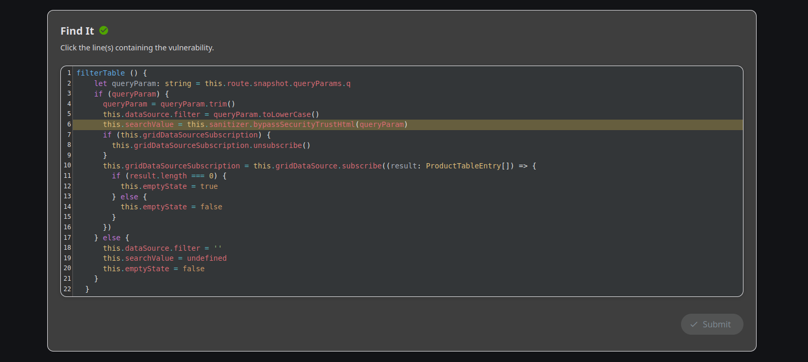
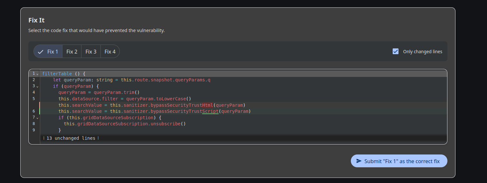
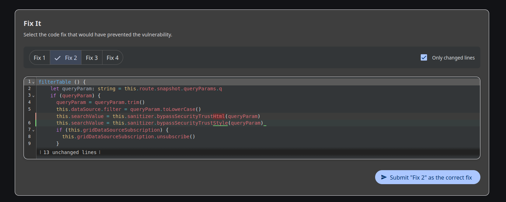
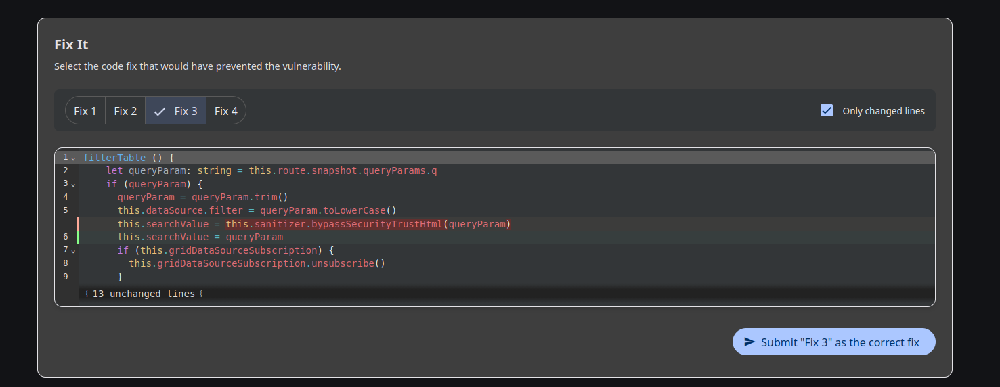
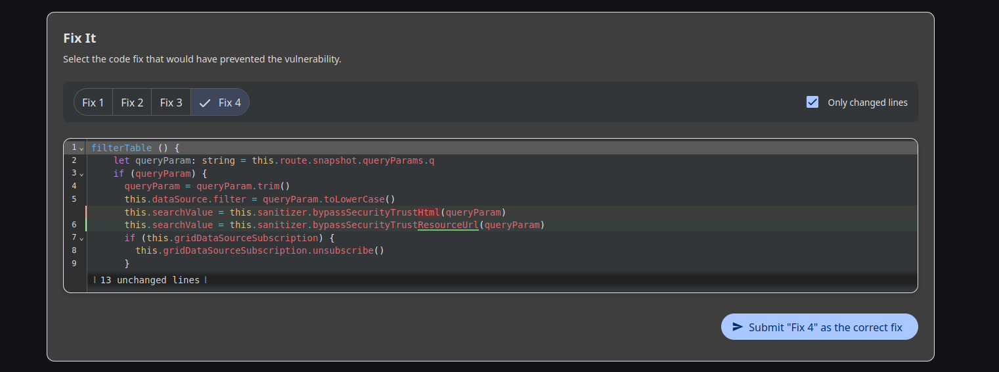

# DOM XSS (Cross-Site Scripting)

**Category:** Cross-Site Scripting (XSS) — OWASP Top 10 A03:2021 (Injection)

> For educational purposes only. Performed on a local, personal OWASP Juice Shop instance.

## Summary

The search field takes the user's input and inserts it into the page as **raw HTML**,
because the application explicitly disables Angular's built-in sanitization. By entering an
HTML/JavaScript payload into the search box, the injected code is executed in the browser.
This is a **DOM-based XSS**: everything happens on the client side (visible by the `#` in
the URL), the server is never involved.

## Steps to Reproduce

1. Open the application at `http://localhost:3000`.
2. In the **search field** (top bar), enter the following payload instead of a normal
   search term:
   ```html
   <iframe src="javascript:alert(`xss`)">
   ```
3. Submit the search. The injected `iframe` runs the `javascript:` URL and an **alert box**
   (`xss`) pops up → the challenge is solved.

## Why it works

A search term is plain text, so Angular would normally **escape** it automatically and the
payload would be shown as harmless text. However, the vulnerable code wraps the input with
`this.sanitizer.bypassSecurityTrustHtml(queryParam)` — the method name says it all: it
**turns off** Angular's protection and tells the framework to trust the input as safe HTML.
The `iframe` is therefore rendered as a real element and its `javascript:` URL executes.

## Dangers and Consequences

With XSS an attacker can run arbitrary JavaScript in the victim's browser. This allows them
to:

- **steal session data and cookies** and impersonate the victim;
- **perform actions in the victim's name** (buy, change or delete something);
- **redirect** the user to a fake page or silently read what they type.

Because the code runs with the victim's identity and permissions, a single injectable
output can fully compromise a user's session.

## Remediation — How to do it right

1. **Never disable the framework's sanitization without a very good reason.** Removing the
   `bypassSecurityTrust…` call lets Angular escape the input automatically.
   ```ts
   // Wrong — protection switched off
   this.searchValue = this.sanitizer.bypassSecurityTrustHtml(queryParam)

   // Correct — input treated as plain text
   this.searchValue = queryParam
   ```
2. **Output user input as text, not HTML.** Use Angular's text interpolation
   (`{{ value }}`); never feed user input into `[innerHTML]`.
3. **If HTML really must be rendered, sanitize it** with a proper sanitizer
   (e.g. DOMPurify) instead of trusting raw input.
4. **Add a Content Security Policy (CSP)** as a second layer that blocks injected scripts
   in the browser.

## Coding Challenge — Find It & Fix It

### Find It — the vulnerable line



Line 6 wraps the search input with `bypassSecurityTrustHtml(queryParam)`, which disables
Angular's sanitization — the root cause of the XSS.

### Fix It — comparing the four options

The *Fix It* phase offers four candidate patches. Only one is correct.

| Fix | Change | Verdict | Why |
|-----|--------|---------|-----|
| **Fix 1** | `bypassSecurityTrustScript(...)` |  Wrong | Just swaps one bypass for another — sanitization is still disabled. |
| **Fix 2** | `bypassSecurityTrustStyle(...)` |  Wrong | Another bypass variant; the protection is still off. |
| **Fix 3** | `this.searchValue = queryParam` |  **Correct** | Removes the bypass entirely and treats the input as plain text. Angular then escapes it automatically. |
| **Fix 4** | `bypassSecurityTrustResourceUrl(...)` |  Wrong | Yet another bypass variant — still trusts the raw input. |

**Fix 1 —  `bypassSecurityTrustScript` (still a bypass)**



**Fix 2 —  `bypassSecurityTrustStyle` (still a bypass)**



**Fix 3 —  removes the bypass, input treated as plain text**



**Fix 4 —  `bypassSecurityTrustResourceUrl` (still a bypass)**



**Official hint:** *"Removing the bypass of sanitization entirely is the best way to fix this
vulnerability. Fiddling with Angular's built-in sanitization was entirely unnecessary, as the
user input for a text search should not be expected to contain HTML that needs to be rendered
but merely plain text."*

**Takeaway:** Fixes 1, 2 and 4 only replace one `bypassSecurityTrust…` call with another —
the protection stays off, so the XSS is **not** fixed. The correct fix (**Fix 3**) removes
the bypass completely and lets Angular treat the search term as plain text.

## Video

[Watch the walkthrough on Loom](https://www.loom.com/share/041c116694414bc996fb86d010a4ebe1)